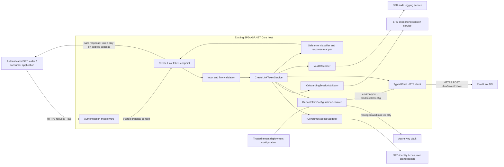
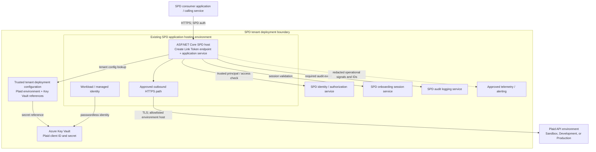
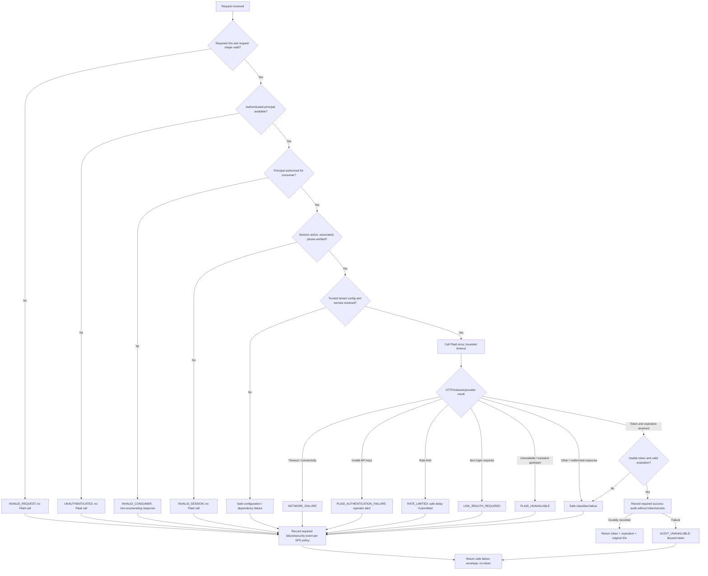

# Architecture: Create Plaid Link Token

**Status**: Proposed logical architecture  
**Feature**: `001-plaid-link-token`  
**Basis**: `plan.md`, `research.md`, `contracts/create-link-token.md`, `data-model.md`, and reviewed feature requirements in `spec_reviewed.md`

## 1. Scope and architecture decisions

This document describes one stateless SPD backend operation that issues a Plaid Link Token for an authenticated consumer. It defines logical components and trust boundaries, not an independently deployable service. The operation runs in the existing SPD ASP.NET Core host, uses no feature database or token cache, and calls SPD and Plaid dependencies through narrow adapters.

Key invariants:

- Validate identifiers, authenticate and authorize the principal, and validate the active phone-verified session before any Plaid token-creation call.
- Resolve the tenant's Plaid environment and Key Vault secret references from trusted deployment context, never from request data.
- Send only the configured `auth` product and `US` country code; `sessionId` is SPD-only and is not sent to Plaid.
- Return a token only after validating the Plaid response and recording the required success audit event.
- Never persist, cache, audit, or routinely log Link Tokens or provider credentials. Discard a token on any post-issuance failure.
- Preserve valid request and correlation IDs across dependency calls and outcomes. Do not invent replacements.
- Do not automatically retry `/link/token/create`; repeated requests are independent and are not guaranteed to be idempotent.

## 2. Component architecture



The caller-to-host link uses the SPD's established HTTPS and authentication conventions. The exact SPD routes, adapter protocols, identity claims, audit event schemas, and service discovery configuration must be bound to existing SPD contracts during implementation; they are not established in this repository.

## 3. Request sequence

The normal path is deliberately ordered. Validation, identity, authorization, session, and trusted configuration checks precede Plaid. The token response is held request-locally until the success audit completes.

```mermaid
sequenceDiagram
    autonumber
    actor Caller as SPD caller
    participant Auth as SPD auth middleware
    participant API as Create Link Token endpoint
    participant App as CreateLinkTokenService
    participant Access as Consumer access adapter
    participant SPD as SPD identity / authorization
    participant Session as Onboarding session adapter
    participant SessionSvc as SPD session service
    participant Config as Tenant configuration resolver
    participant KV as Azure Key Vault
    participant Plaid as Typed Plaid client / Plaid API
    participant Audit as SPD audit service

    Caller->>Auth: POST request + consumerId, sessionId, requestId, correlationId
    Auth->>API: Trusted principal context (or authentication rejection)
    API->>App: CreateLinkTokenCommand
    App->>App: Validate required IDs and request shape
    App->>Access: Authorize principal for consumerId
    Access->>SPD: Check principal-to-consumer access
    SPD-->>Access: Authorized / denied
    Access-->>App: Access result
    App->>Session: Validate active session and phone verification
    Session->>SessionSvc: Check sessionId belongs to consumerId and is active/verified
    SessionSvc-->>Session: Session result
    Session-->>App: Valid / invalid
    App->>Config: Resolve trusted tenant environment and Plaid settings
    Config->>KV: Get referenced credentials using managed/workload identity
    KV-->>Config: Secret values
    Config-->>App: Allowlisted environment, credentials, clientName, language, non-PII user ID
    App->>Plaid: Create token (auth, US; no sessionId; trace context)
    Plaid-->>App: link_token, expiration OR provider error
    App->>App: Validate non-empty token and parseable expiration
    App->>Audit: Record issued outcome (IDs, approved consumer reference, classification; no token/secrets)
    Audit-->>App: Durable audit accepted
    App-->>API: CreateLinkTokenResult
    API-->>Caller: Success with token, expiration, original IDs
```

Authentication middleware can reject before the application service runs. Required audit events also apply to relevant denied/failed outcomes according to SPD audit conventions. Their exact event taxonomy and whether malformed requests are auditable must be aligned with the existing audit contract. A failed required success audit always prevents returning the token.

## 4. Deployment architecture

The following is a logical deployment view, not a claim about existing infrastructure resources. The plan identifies an existing SPD host and Azure Key Vault but provides no deployment manifests, network topology, scale settings, or concrete SPD endpoint definitions.



### Deployment responsibilities and constraints

- **Application runtime**: Deploy as part of the existing SPD host using its established routing, authentication, health, scaling, and release conventions. Do not create a new database, worker, or standalone service solely for this operation.
- **Environment selection**: Map trusted tenant/deployment configuration to the approved Plaid Sandbox, Development, or Production endpoint. Validate the base URL against an allowlist; never accept arbitrary hosts or environment selectors from callers.
- **Secrets**: Store Plaid secret material in Azure Key Vault. Use managed identity/workload identity in deployed environments and the approved developer identity locally. Secret references belong in trusted configuration; secret values must not appear in source, deployment logs, or diagnostics.
- **Network**: Permit outbound TLS only to the configured Plaid environment and required SPD dependencies under the host's network policy. Exact firewall, DNS, private endpoint, and proxy rules are deployment-specific and remain to be confirmed.
- **Availability and latency**: Use bounded dependency timeouts and report measured end-to-end success latency against NFR-001 (95% within 3 seconds under normal dependency conditions). Do not introduce retries for token creation. Host sizing and request-volume limits follow SPD capacity policy.
- **Observability**: Emit approved classifications, timings, and trace identifiers. Redact provider headers and request/response bodies; exclude token-bearing response content. Alert on credential/authentication failures and dependency health using SPD-approved monitoring.

## 5. Security architecture

### Trust boundaries

1. **Caller to SPD host**: The host authenticates the request. Identity is obtained only from trusted middleware/context, never from a body field. Authorization is evaluated for the requested Consumer ID, with non-enumerating denial behavior.
2. **Application to SPD dependencies**: Identity/access, session, and audit integrations use existing SPD authentication and service contracts. Request/correlation IDs are propagated only through approved headers or context mechanisms.
3. **Application to Key Vault**: The runtime authenticates with managed/workload identity. Secret references and tenant context are trusted configuration; secret values remain in memory only as required for the provider call.
4. **Application to Plaid**: HTTPS to the allowlisted environment. Provider credentials are attached according to the selected Plaid API version's supported authentication contract and are excluded from logs and exception text.
5. **Application to caller**: Only the authorized caller receives the token. Failure envelopes never include partial token data, credentials, raw provider messages, or sensitive internal details.

### Controls

| Threat / concern | Architecture control |
| --- | --- |
| Forged identity or cross-consumer access | Require SPD authentication; authorize the trusted principal for `consumerId`; avoid revealing whether another consumer exists. |
| Invalid or unrelated onboarding session | Require an active session tied to the same consumer with phone verification complete before Plaid is called. |
| Tenant/environment confusion or SSRF | Derive environment from trusted tenant deployment context; map to allowlisted Plaid base URLs; reject request-provided routing. |
| Credential disclosure | Key Vault plus managed/workload identity; redact secret headers and payloads; exclude credentials from API responses, logs, audit, and telemetry. |
| Token leakage or excessive retention | Request-local memory only; no database, cache, audit field, routine logging, or exception text; discard on every failure, including audit failure. |
| Sensitive provider diagnostics | Classify by stable provider `error_type`/`error_code`; do not return raw body, `display_message`, or internal host details. |
| Request spoofing / trace loss | Validate caller-supplied request/correlation IDs; preserve valid values unchanged; do not generate replacements; use approved propagation mechanisms. |
| Replay or duplicate issuance assumptions | No idempotency promise and no automatic create retry; callers must treat repeated requests as independent issuance attempts. |
| Excessive dependency exposure | Bounded timeouts, TLS, narrowly scoped adapters, and deployment egress restrictions. |
| Audit bypass | Fail closed for successful issuance: no response token unless the required success audit has durably completed. |

The `client_user_id` sent to Plaid must be a stable, unique, SPD-approved non-PII identifier. Do not use phone number, email, access token, or `sessionId`. Confirm whether the consumer key can be used directly or must be transformed under SPD privacy policy. Do not forward the SPD session ID to Plaid.

## 6. Class and interface responsibilities

These are proposed logical types aligned with the plan and contracts, not existing source files. Names can be adapted to SPD conventions without changing the responsibility boundaries.

| Type | Layer | Responsibility / invariants |
| --- | --- | --- |
| `CreateLinkTokenRequest` | API | Deserialize only caller-controlled fields (`sessionId`, `requestId`, `correlationId`); do not accept trusted principal, environment, credentials, products, or country codes. Consumer ID has one canonical source (route or body). |
| `CreateLinkTokenEndpoint` | API | Map the established SPD route and HTTP contract to the application command; obtain principal from middleware; map success/failure to safe response envelopes. |
| `CreateLinkTokenCommand` | Application/domain | Carry validated consumer/session/request/correlation IDs plus server-trusted principal and tenant context. Enforce that trust-derived values are not caller-deserialized. |
| `CreateLinkTokenService` | Application | Orchestrate validation, consumer authorization, session verification, tenant configuration, Plaid call, response validation, audit, and result creation in the required order. Return either a complete result or a classified failure, never both. |
| `RequestIdentifierValidator` (or equivalent) | Application/domain | Validate required ID formats and request shape before dependency calls; preserve valid supplied IDs; never manufacture replacements. |
| `IConsumerAccessValidator` | Port | Check authenticated principal and authorization for the requested consumer; return a non-enumerating denial result. |
| `IOnboardingSessionValidator` | Port | Verify session exists, is active, belongs to the consumer, and satisfies phone-verification state. |
| `ITenantPlaidConfigurationResolver` | Port | Resolve trusted tenant environment, allowlisted base URL, Key Vault references, client name, language, and approved non-PII Plaid user ID mapping. |
| `PlaidEnvironmentConfiguration` | Domain/configuration | Represent the resolved environment, allowlisted base URL, secret references, client name, language, and approved non-PII Plaid user ID; never accept it from caller input. |
| `IAuditRecorder` | Port | Record required decision/outcome events with valid trace IDs and minimal approved consumer reference; its event model must have no token or credential field. |
| `AuditEvent` | Domain/integration | Carry the event type, valid request/correlation IDs, minimal approved consumer reference, safe outcome classification, and timestamp; structurally exclude token and credentials. |
| `PlaidLinkTokenClient` | Infrastructure | Typed `HttpClient` adapter for `/link/token/create`; construct fixed `products: ["auth"]` and `country_codes: ["US"]`; apply bounded timeout and approved trace propagation; perform no automatic retries. |
| `PlaidResponseValidator` | Infrastructure/application | Reject missing/empty token or invalid/missing ISO-8601 expiration; retain the provider expiration instant without extending or inferring it. |
| `PlaidErrorTranslator` | Infrastructure | Map provider error types/codes such as `INVALID_API_KEYS`, `RATE_LIMIT_EXCEEDED`, and `ITEM_LOGIN_REQUIRED` to stable internal classifications and retry guidance; avoid raw provider text. Validate mappings against the current Plaid catalog. |
| `OperationFailure` | Domain | Hold a safe stable SPD code, generic message, retryability, optional safe retry delay, and valid IDs; never contain a token. |
| `CreateLinkTokenResult` | Domain/API | Hold the token only for the in-flight response, Plaid expiration, and original IDs; prevent logging/serialization outside the success response path. |
| SPD adapters | Infrastructure | Bind the logical ports to existing SPD identity/session/audit contracts; wire protocols and endpoint details are intentionally unspecified until those contracts are available. |

## 7. Error handling flows

### Decision flow



### Classification and response behavior

| Failure point | Classification / handling | Plaid called? | Response and audit behavior |
| --- | --- | ---: | --- |
| Missing/malformed request, consumer, session, or trace ID | `INVALID_REQUEST` | No | Preserve only valid supplied IDs; emit required security/failure audit event per SPD policy; no fabricated IDs. |
| Authentication absent/invalid | `UNAUTHENTICATED` | No | No token; record required security outcome according to SPD conventions. |
| Consumer authorization denied | `INVALID_CONSUMER` | No | Non-enumerating response; no token; record approved outcome. |
| Session inactive, mismatched, or not phone-verified | `INVALID_SESSION` | No | No token; record approved outcome. |
| Tenant config / Key Vault resolution failure | Safe configuration or dependency failure (map to SPD's stable code; do not reveal secret/reference details) | No | No token; alert through approved operational channel as appropriate. |
| Network timeout/connectivity | `NETWORK_FAILURE` | Yes | Caller retry guidance may be provided; the service does not retry token creation. Preserve valid IDs. |
| Plaid invalid credentials (`INVALID_API_KEYS`) | `PLAID_AUTHENTICATION_FAILURE` | Yes | Non-retryable by caller; operator action/alert; no raw provider details. |
| Plaid rate limit (`RATE_LIMIT_EXCEEDED`) | `RATE_LIMITED` | Yes | Retry only after safe delay; expose `Retry-After` only if SPD conventions allow. |
| Plaid item login required (`ITEM_LOGIN_REQUIRED`) | `LINK_REAUTH_REQUIRED` | Yes | No blind retry; caller initiates appropriate Link recovery/update flow. |
| Plaid outage/transient upstream failure | `PLAID_UNAVAILABLE` | Yes | Safe caller retry guidance; no automatic create retry. |
| Plaid response missing token or invalid/missing expiration | Provider failure / safe internal classification | Yes | Discard partial response; no token; audit failure outcome. |
| Required success audit fails after token issuance | `AUDIT_UNAVAILABLE` | Yes | Discard token; do not return partial success. A later caller retry is an independent issuance attempt. |
| Unexpected exception | `INTERNAL_ERROR` | Depends on failure point | Generic message only; retain approved trace IDs and emit redacted diagnostics. |

Failure audit writes must never contain a token or credentials. If recording a failure event itself fails, do not replace the original safe failure with sensitive diagnostics; report the audit dependency failure only through approved internal telemetry. The SPD audit contract must define whether such secondary audit failure overrides a caller-facing failure code. For a success-path audit failure, `AUDIT_UNAVAILABLE` takes precedence because success cannot be returned.

All external calls need finite timeouts. Avoid logging exception objects or HTTP request/response content if they may include secrets or token material. Keep provider classifications in restricted operational telemetry only when allowed; caller-facing responses always use stable SPD codes and generic safe messages.

## 8. Open integration decisions

The following are intentionally deferred because the artifacts and workspace do not define them:

- Existing SPD route/versioning, HTTP status conventions, response envelope, auth mechanism, and canonical location of Consumer ID.
- Identity, onboarding-session, and audit service endpoints, authentication, schemas, timeouts, and event names.
- Plaid API version and exact credential header placement; use the supported contract for the chosen version and redact those headers.
- Tenant-to-environment mapping, Key Vault naming/reference conventions, identity permissions, and deployment network rules.
- SPD-approved non-PII `client_user_id` derivation and the audit service's failure-event policy.
- Concrete hosting platform, deployment manifests, sizing, scaling, and alert thresholds.

These decisions must be resolved by binding the logical ports to existing SPD contracts before implementation. They must not be resolved by accepting privileged configuration from callers or inventing unsupported SPD wire formats.
